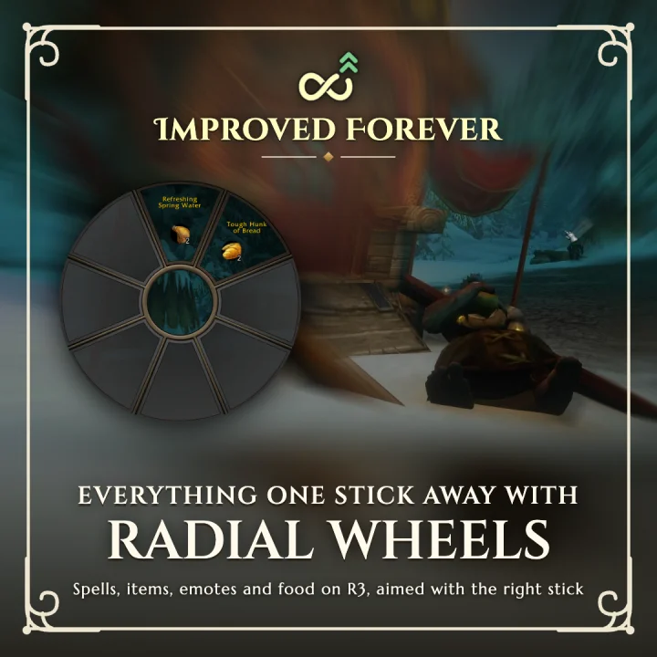
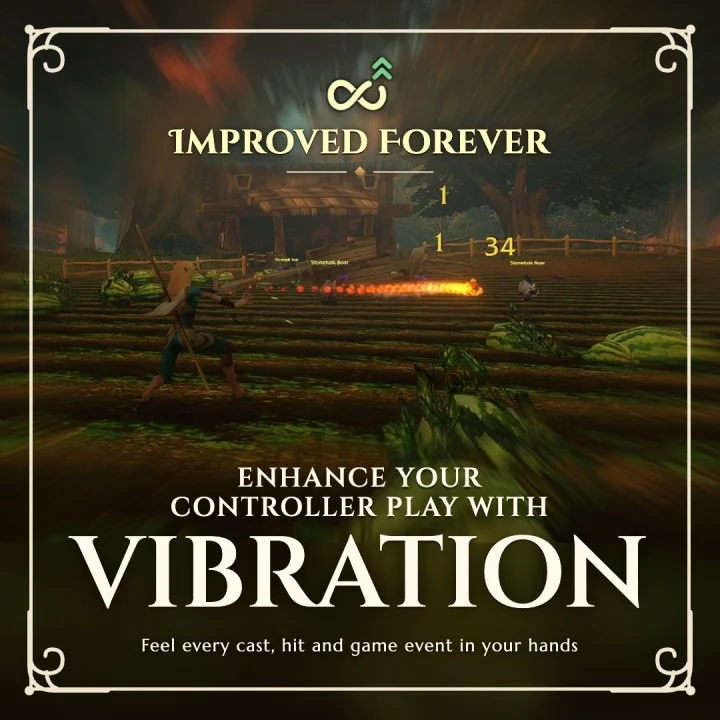
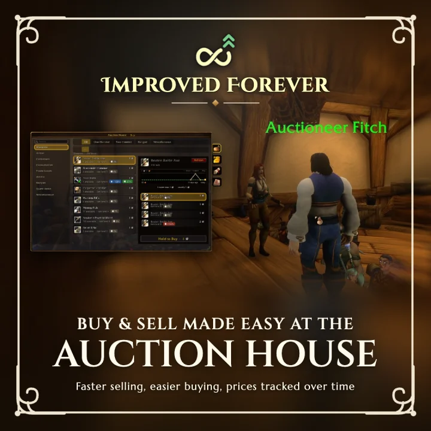
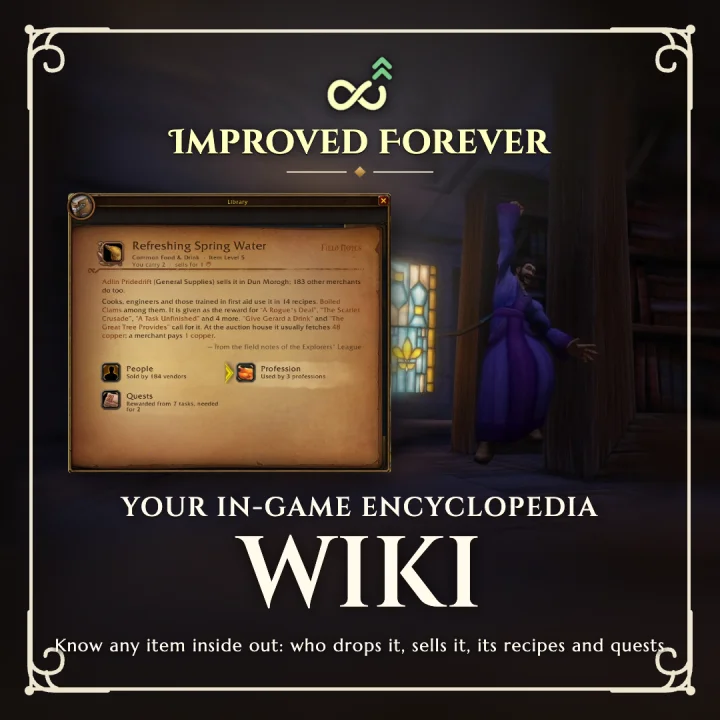
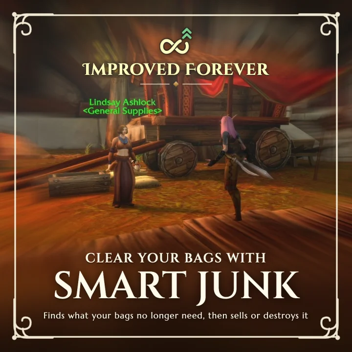
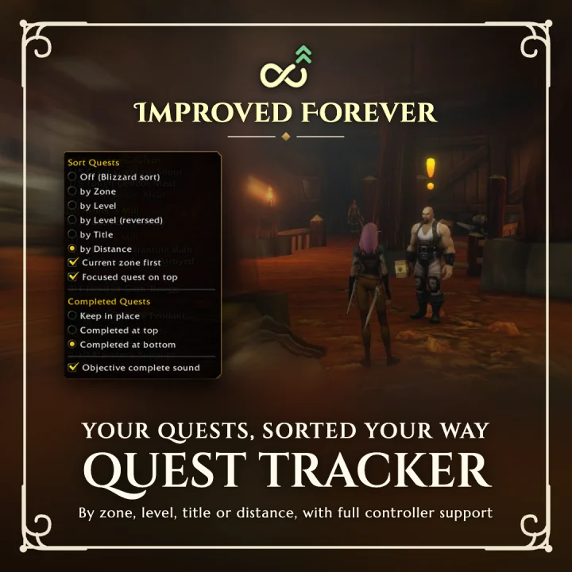
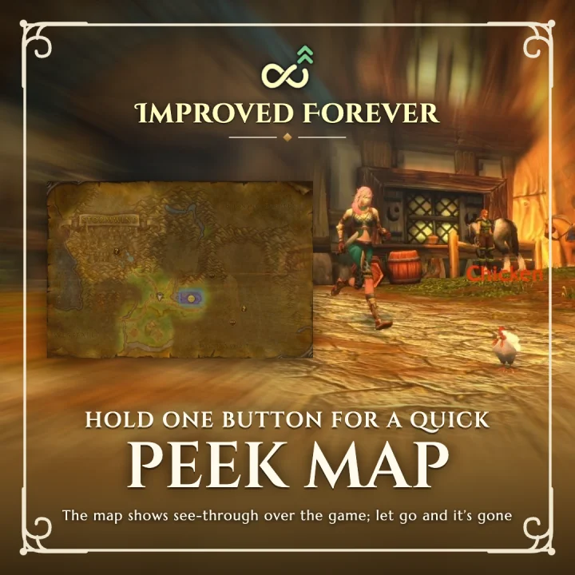
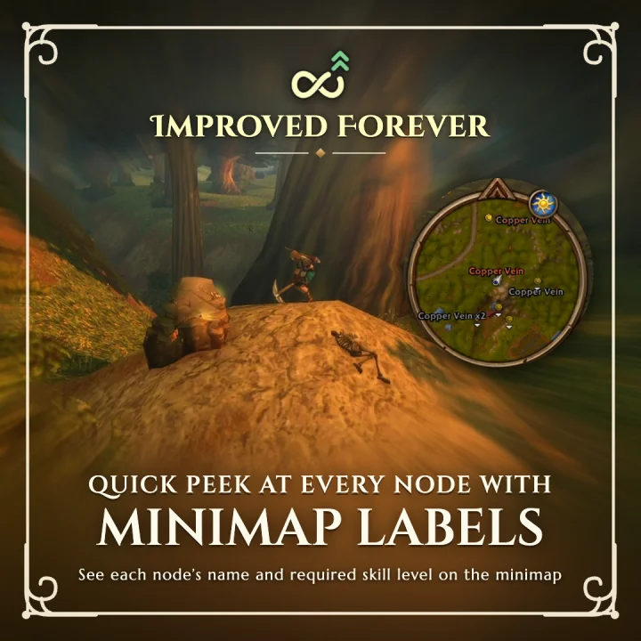

# Improved Forever - Controller & Gamepad

The **controller / gamepad** addon for **WoW Forever**: quality-of-life tweaks that make playing
with a controller even better. Works with Xbox, PlayStation (DualSense) and Switch Pro controllers.
Everything is set up and used from the controller, no keyboard step needed. Every module but
Controller and Wheel works with the mouse and keyboard too: the windows follow what you used last
(the pad's legend and cursor with the pad; buttons to click, the wheel to scroll, tooltips on hover
and Esc with the mouse).

Free on [CurseForge](https://www.curseforge.com/wow/addons/improved-forever).

  
  
  
  
   
  
  
  
  

Each feature is its own addon (enable only the ones you want in the AddOns list); all of them need
the core, **Improved Forever**:

| Addon | What it does |
|---|---|
| `ImprovedForever` | The core: button glyphs, the configuration panel, the Bindings tab (every press on one drawing of the controller, and its keyboard / mouse press), bag clean-up, touchpad corners, the game data (QuestieDB's, recipes) and the item verdict every module shares. Required. Holds the former Controller module. |
| `ImprovedForever_Wheel` | Wheels on R3 combos, the recent action slot. |
| `ImprovedForever_Vibration` | Vibration on game events and spell casts. |
| `ImprovedForever_Minimap` | Names beside the minimap's dots (herbs, ore, quests, NPCs, party members: you choose), gathering alerts. Formerly Gather. |
| `ImprovedForever_Map` | The peek map. |
| `ImprovedForever_Chat` | The chat with the controller: pick a line, then an item or other link in it. |
| `ImprovedForever_Auction` | The controller auction window, prices over time, tasks. |
| `ImprovedForever_Junk` | Finds and marks junk, sells it with the vendor's Sell All Junk, destroys it from the bags or the loot window. Formerly Destroy. |
| `ImprovedForever_Wiki` | Everything about an item. |
| `ImprovedForever_Journal` | A diary of your days, read as a book. |
| `ImprovedForever_Fishing` | Fishing from the controller: fishing mode, a cast bar of its own, the session's stringer, the Fish Collection. |
| `ImprovedForever_Immersion` | The game's HUD made immersive: the target's health across the top, yours bottom left in the same look, your pet and party as cards on the experience line, the gamepad bar as Hogwarts Legacy's spell diamonds bottom right, the chat as just its lines until used. |
| `ImprovedForever_QuestTracker` | The objective tracker, rebuilt as the game's own: sorted quests (zone, level, title, distance, completed), an objective complete sound, full controller support. Formerly Improved Quest Tracker. |

## Features

- **Wheels** on R3 combos, laid out like the game's radial menu. Built in: **Quest Items** and
  **Consumables** (each fills itself from your bags) and **Emotes**. Make wheels of your own, mixing
  spells, items, macros, emotes and chat phrases you add (D-pad up / down picks a phrase's channel on
  the wheel), or a shaman's totems, or a trinket swap. Aim with the right stick.
- **Recent action slot** on R3, placed in Edit Mode.
- **Touchpad** corner actions.
- **Chat lines**: with the chat open on the controller, D-pad Up picks its lines, left / right the links in a line
  (their tooltips); Cross opens an item in the Wiki, Square puts the link in your message.
- **Button overrides** for L3 click and double-click.
- **Vibration** on game events and spell casts, with per-action patterns.
- **Junk**: what the bags no longer need is marked junk (the game's coin on its slot), from quests (QuestieDB's
  data), your professions' recipes, auction prices, your class and whether it's soulbound. L2 + L3 on a bag item
  marks it junk or not junk, remembered per character. A vendor's Sell All Junk sells it all. Its **Destroy**
  panel throws junk away from the controller; from the loot window when the bags are full, it destroys junk
  and loots in its place. The auction window's Sell tab sorts the bags by the same verdict.
- **Wiki**: hold R3 on an item (bags, loot window, auction house) for everything about it: what drops
  it, who sells it, the recipes that make or use it, its quests and auction prices. Drops, vendors and
  quests come from [QuestieDB](https://github.com/Questie/QuestieDB)'s data: the addon when installed, else
  a copy that ships with the core.
- **Fishing**: with a pole in hand, R2 twice (or a double right-click) starts fishing mode: R2 casts, R2
  twice puts your best lure on, Circle or Esc stops. Each cast is its own scene (the HUD steps back, the
  camera comes in, the fish of that water swim round your bobber), the catches hang on a stringer under
  the minimap, and the **Fish Collection** (D-pad up) keeps every fish you've caught, with a cinematic
  for each new one. Triangle frames the fishing camera.
- **Journal**: a diary of each day you play, per character: the lands you passed through, the quests you
  finished, your fights and falls, what you looted, earned and made, written in your own words. Read it in
  a book like the Wiki's (`/if journal`, a key binding or a wheel); with the Wiki, a quest, creature or item
  in it opens its page.

**Bindings**: every binding has a controller press and a keyboard / mouse press, both working, set
on the Bindings tab (or the module's own tab): record either, it goes on the press of the input you
used. A keyboard / mouse press is a key (Alt / Ctrl / Shift held too, if you like) or, for an item's
binding, a modified click on an item. By default Alt + click an item (bags, loot window, chat links)
opens it in the Wiki and Alt + right-click a bag item marks it junk or not junk; a key on those acts
on the item under the mouse. `/if input pad` or `/if input mouse` keeps the windows on one
(`/if input auto`: the one used last).

Double-tap **Menu** (or `/if`) to open the configuration: a tab per loaded module down the right
(L1 / R1, or the right stick), the module's sections down the left (the left stick, or L2 / R2), its
settings in the middle (left / right change one, Cross picks from its list on the right).

## Install

- **CurseForge app**: search *Improved Forever* and install the modules you want (*Improved
  Forever: Wheel*, *Improved Forever: Auction*...); each brings the core along.
- **Manual**: download the core's zip (`ImprovedForever-<version>.zip`) and each module's own
  (`ImprovedForever_<Module>-<version>.zip`) from
  [Releases](https://github.com/markgravity/ImprovedForever/releases) and unzip them into
  `World of Warcraft/_forever_/Interface/AddOns/` so you get `AddOns/ImprovedForever/`,
  `AddOns/ImprovedForever_Wheel/`... (remove an old `AddOns/ImprovedController/`).

## Development

One repo, one folder per addon (`ImprovedForever/` the core, `ImprovedForever_<Module>/` each module).
Link them into the game with `tools/link.sh "<game>/Interface/AddOns"` and `/reload` in game.

A module reaches the core through the global `ImprovedForever` (`local IF = ImprovedForever`), says it
is there with `IF.AddModule`, adds its presses with `IF.Binds.Add`, its commands with `IF.AddCommand`
and its settings tab with `IF.SettingsPage` (form fields) or `IF.Menu.AddTab` (a page of its own).
Another module's table (`IF.Auction`, `IF.Vibe`...) is used only after checking it is loaded.

`luajit tools/loadcheck.lua each` loads the core with each module alone, then all of them, against a
stand-in for the game's API, and drives the configuration panel: it catches a module reaching for
one that isn't loaded.

`vendor/QuestieDB` is a git submodule of [QuestieDB](https://github.com/Questie/QuestieDB), for its API
types and data (`git submodule update --init`). `python tools/make_library_data.py` copies what the
Wiki and the item verdict need from it into the core's `ImprovedForever/WorldData.lua`, which ships; the
submodule itself isn't packaged.

- `python tools/sync_forever_data.py` syncs all the game data with WoW Forever (QuestieDB moved to its
  latest, `RecipeData.lua` and `WorldData.lua` rebuilt) and checks the IDs written in the code; `--check`
  only checks.
- `python tools/make_library.py` regenerates the core's `ImprovedForever/RecipeData.lua` from Forever's own
  recipe tables (wago.tools).
- The other `tools/make_*.py` regenerate the TGA textures (`ImprovedForever/textures/`).
- `python tools/package.py` builds a zip per addon in `dist/` and `ImprovedForever-All.zip` with every addon; `python tools/package.py Wheel` builds only that one.
- `python tools/make_module_icons.py --logos` also writes each module's CurseForge logo to `dist/logos/`.

### Releasing

Each addon is versioned and released on its own: tag only the ones you changed.

1. `python tools/release.py changed` lists the addons touched since their last tag.
2. Bump `## Version:` in those addons' TOCs only.
3. Add a `## <Name> <version>` section (e.g. `## Wheel 0.6.1`) on top of `CHANGELOG.md` for each.
4. Commit, then tag each: `git tag Wheel-v0.6.1 && git push origin main Wheel-v0.6.1`.
   `<Name>` is the folder without `ImprovedForever_` (`Core` for `ImprovedForever`).

The [release workflow](.github/workflows/release.yml) runs per tag: it checks the tag matches that
addon's TOC, builds its zip, creates the GitHub release with its changelog section, and uploads the
zip to its CurseForge project (`## X-Curse-Project-ID` in its TOC) when `CF_API_KEY` is set. A tag
with a suffix (`Wheel-v0.7.0-beta1`) makes a pre-release / beta.

## Support

Improved Forever is free and always will be. If it makes your game better and you'd like to
say thanks, you can buy me a coffee:

- [Ko-fi](https://ko-fi.com/markgravity)
- [PayPal](https://paypal.me/markgravity)

## Credits

The Wiki's drop, vendor and quest data comes from [QuestieDB](https://github.com/Questie/QuestieDB)
by the Questie team; creatures' display ids (their portraits) from
[cMaNGOS classic-db](https://github.com/cmangos/classic-db) (GPL-3.0).

Parts of the code are adapted from
[Easy Controller - Forever](https://github.com/moust4ki/EasyControllerWowForever) by moust4ki
(MIT): see [LICENSE-EasyController.md](LICENSE-EasyController.md).

## License

[MIT](LICENSE)
